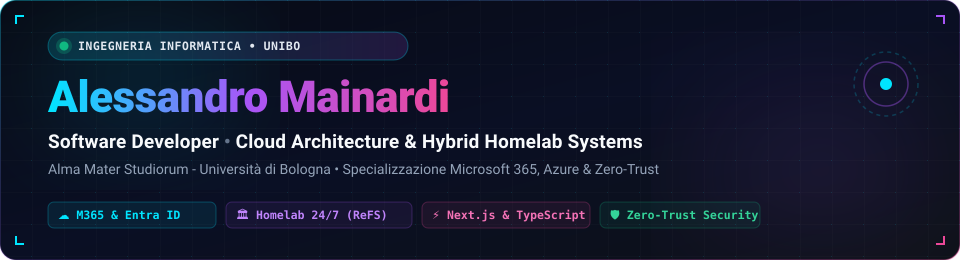

<div align="center">



<br>

[](https://alexmaina.dev/)
[](https://bio.alexmaina.dev/)
[](https://doi.org/10.5281/zenodo.23781231)
[](https://www.wikidata.org/wiki/Q141886579)
[](https://orcid.org/0009-0003-7003-7247)
[](https://alexmaina.dev/guide/)
[](https://www.linkedin.com/in/alessandro-mainardi-ab812823b/)
[](https://x.com/Alex_Maina_)
[](mailto:maina@alexmaina.dev)

</div>

---

### 👨‍💻 Engineering Snapshot

```json
{
  "name": "Alessandro Mainardi",
  "role": "Software Developer & Computer Engineering Student",
  "institution": "Alma Mater Studiorum - Università di Bologna (UniBo)",
  "degree_course": "Ingegneria Informatica (Computer Science & Engineering)",
  "orcid": "https://orcid.org/0009-0003-7003-7247",
  "location": "Bologna, Italy 🇮🇹",
  "core_competencies": {
    "cloud_enterprise": ["Microsoft 365", "Microsoft Entra ID", "Microsoft Azure", "Intune MDM"],
    "systems_infrastructure": ["Windows Server 2025", "Hyper-V", "Storage Spaces ReFS", "Docker"],
    "zero_trust_networking": ["Tailscale WireGuard Mesh", "Cloudflare Outbound Tunnels"],
    "software_engineering": ["Swift 5.10", "TypeScript", "Next.js 15", "React 19", "Python"],
    "health_informatics": ["HL7 CDA R2", "Apple HealthKit", "LOINC", "Zero-Cloud Mobile Edge"]
  },
  "engineering_ethos": "Building resilient, sovereign, and zero-compromise systems"
}
```

---

### ⭐ Showcase Progetti & Architetture

<table>
  <tr>
    <td colspan="2" valign="top">
      <h3 align="center">⚕️ RosettaEdge — Mobile Edge Zero-Cloud &amp; FSE 2.0</h3>
      <p align="center">
        <a href="https://alexmaina.dev/Health-App/"><b>[Landing &amp; Docs ↗]</b></a> • 
        <a href="https://alexmaina.dev/Health-App/rosettaedge-monografia-tecnica.pdf"><b>[Monografia Tecnica A4 (PDF) ↗]</b></a> • 
        <a href="https://doi.org/10.5281/zenodo.23781231"><b>[DOI Zenodo ↗]</b></a> • 
        <a href="https://github.com/AlexMaina05/Health-App"><b>[Repository GitHub]</b></a>
      </p>
      <p>Architettura software nativa iOS/watchOS per l'interoperabilità semantica deterministica tra Fascicolo Sanitario Elettronico (HL7 CDA R2) e Apple HealthKit con tecnologia Zero-Cloud e crittografia hardware Secure Enclave conforme GDPR Art. 9:</p>
      <ul>
        <li><b>Monografia Scientifica Peer-Reviewed (44 Pagine ISO A4):</b> Documentazione teorica ed empirica completa (<a href="https://doi.org/10.5281/zenodo.23781231">DOI: 10.5281/zenodo.23781231</a>).</li>
        <li><b>Motore di Transcodifica Deterministico:</b> Mappatura ontologica bidirezionale LOINC ↔ HealthKit con garanzie matematiche di non-alterazione semantica e latenze on-device &lt; 100ms.</li>
        <li><b>Privacy-by-Design &amp; Identity Firewall:</b> Elaborazione esclusivamente on-device, nessun dato trasmesso a server terzi o cloud.</li>
      </ul>
      <p><b>Stack:</b> <code>Swift 5.10</code> <code>Apple HealthKit</code> <code>Core Data</code> <code>CryptoKit</code> <code>HL7 CDA R2</code> <code>LOINC Standard</code> <code>Zero-Cloud</code></p>
    </td>
  </tr>
  <tr>
    <td width="50%" valign="top">
      <h3 align="center">🚀 GitOps Auto-Deployer</h3>
      <p align="center">
        <a href="https://doi.org/10.5281/zenodo.23781231"><b>[DOI Zenodo ↗]</b></a> • 
        <a href="https://github.com/AlexMaina05/gitops_deployer"><b>[Repository GitHub]</b></a>
      </p>
      <p>Microservizio asincrono sviluppato in Python con FastAPI per la continuous delivery di stack containerizzati con sicurezza crittografica HMAC-SHA256 e notifiche Telegram/n8n:</p>
      <ul>
        <li><b>118 Test Unitari & Adversarial:</b> Suite completa con prevenzione timing attack e command injection.</li>
        <li><b>DOI Cern/Zenodo:</b> Software archiviato e citabile scientificamente (DOI 10.5281/zenodo.23781231).</li>
      </ul>
      <p><b>Stack:</b> <code>Python 3.12</code> <code>FastAPI</code> <code>Docker Compose</code> <code>HMAC-SHA256</code> <code>Telegram API</code> <code>uv</code></p>
    </td>
    <td width="50%" valign="top">
      <h3 align="center">🏛️ HP Fortress Homelab</h3>
      <p align="center">
        <a href="https://alexmaina.dev/hp-fortress-homelab/"><b>[Portale Live ↗]</b></a> • 
        <a href="https://github.com/AlexMaina05/hp-fortress-homelab"><b>[Repository GitHub]</b></a>
      </p>
      <p>Infrastruttura server enterprise ibrida on-premise operativa 24/7 su Windows Server 2025, Hyper-V, ReFS e rete Zero-Trust Cloudflare/Tailscale.</p>
      <p><b>Stack:</b> <code>Windows Server 2025</code> <code>Hyper-V</code> <code>Docker</code> <code>Tailscale</code> <code>Cloudflare</code> <code>ReFS</code> <code>Veeam</code></p>
    </td>
  </tr>
  <tr>
    <td width="50%" valign="top">
      <h3 align="center">🛡️ PII Redactor Lite</h3>
      <p align="center">
        <a href="https://github.com/AlexMaina05/pii-redactor-lite"><b>[Repository GitHub ↗]</b></a>
      </p>
      <p>Applicazione per la sanitizzazione intelligente e reversibile di dati personali identificabili (PII) prima della condivisione con LLM:</p>
      <ul>
        <li>Riconoscimento ed estrazione entità contestuale tramite Google Gemini Flash-Lite.</li>
        <li>Sostituzione con token crittografici reversibili per permettere la de-anonimizzazione autorizzata a valle.</li>
      </ul>
      <p><b>Stack:</b> <code>TypeScript</code> <code>Gemini Flash-Lite</code> <code>Privacy by Design</code></p>
    </td>
    <td width="50%" valign="top">
      <h3 align="center">📐 3D Parametric CAD Web</h3>
      <p align="center">
        <a href="https://github.com/AlexMaina05/3d-model"><b>[Repository GitHub ↗]</b></a>
      </p>
      <p>Modellatore CAD parametrico client-side eseguibile interamente nel browser per la prototipazione rapida e la stampa 3D FDM/SLA:</p>
      <ul>
        <li>Kernel geometrico OpenCascade compilato in WebAssembly (WASM).</li>
        <li>Generazione ed esportazione parametrica di mesh e solidi nei formati standard STL e STEP.</li>
      </ul>
      <p><b>Stack:</b> <code>TypeScript</code> <code>Replicad</code> <code>OpenCascade WASM</code> <code>3D Graphics</code></p>
    </td>
  </tr>
</table>

---

### 🛠️ Stack Tecnologico & Strumenti

<div align="center">

#### 💻 Linguaggi di Programmazione


#### ☁️ Cloud, Sistemi & Reti


#### ⚡ Framework & Strumenti Web


</div>

---

### 📚 Archivio Didattico & Guide Tecniche Open Source

Documento regolarmente le mie sperimentazioni, architetture e percorsi di studio nell'hub open source [alexmaina.dev/guide/](https://alexmaina.dev/guide/):

| Categoria | Argomento Guida | Risorsa & Documentazione |
| :--- | :--- | :--- |
| ☁️ **Cloud M365** | Percorsi Certificazioni Microsoft 365, Copilot & Azure | [ms365/](https://alexmaina.dev/ms365/) |
| 🐳 **Docker & SSL** | Risolvere Loop "Too Many Redirects" su WordPress Docker | [wordpress-docker-redirect-loop/](https://alexmaina.dev/wordpress-docker-redirect-loop/) |
| 🛡️ **Entra ID** | Risoluzione Errore AADSTS50011 (Redirect URI Mismatch) | [entra-id-redirect-uri-aadsts50011/](https://alexmaina.dev/entra-id-redirect-uri-aadsts50011/) |
| 💾 **Storage QNAP** | QNAP Container Station: Conflitti Porte 80/443 & Reverse Proxy | [qnap-docker-reverse-proxy/](https://alexmaina.dev/qnap-docker-reverse-proxy/) |
| ⚡ **M365 Automazione** | Rinnovo Automatico Tenant M365 E5 Developer (90 Giorni) | [m365-developer-rinnovo-automatico/](https://alexmaina.dev/m365-developer-rinnovo-automatico/) |
| 🔒 **Zero-Trust** | Tailscale Subnet Router & Pi-hole Anti-CGNAT | [tailscale-pihole-homelab-cgnat/](https://alexmaina.dev/tailscale-pihole-homelab-cgnat/) |
| 🐍 **Modern Python** | Modern Python con uv, Lockfile Deterministico & CI/CD Ultra-Rapida | [python-uv-github-actions/](https://alexmaina.dev/python-uv-github-actions/) |
| 🔧 **M365 Sandbox** | Configurazione Developer Zero-Risk & Sync-Magic | [configurazione-developer-zerorisk/](https://alexmaina.dev/configurazione-developer-zerorisk/) |
| 🛡️ **Cybersecurity** | Guida alla Sicurezza Informatica Base & Privacy | [sicurezza/](https://alexmaina.dev/sicurezza/) |
| 🌐 **Hosting NAS** | Web App WordPress e Database su NAS QNAP | [wordpress-su-nas/](https://alexmaina.dev/wordpress-su-nas/) |
| 🐍 **Linguaggi** | Guida Completa a Python per Principianti | [guida_python/](https://alexmaina.dev/guida_python/) |
| ⚡ **Frontend** | Sviluppo Web Statico con GitHub Pages & Custom Domain | [guida_sito/](https://alexmaina.dev/guida_sito/) |
| 🧮 **Web App** | Calcolatrice Reattiva con HTML, CSS e JavaScript | [guida_calculator/](https://alexmaina.dev/guida_calculator/) |
| 🏓 **Gamedev** | Gioco Pong con HTML5 Canvas e Loop a 60 FPS | [guida_pong/](https://alexmaina.dev/guida_pong/) |
| ✒️ **Documentazione** | Guida Completa al Linguaggio Markdown per Developer | [guida_markdown/](https://alexmaina.dev/guida_markdown/) |

---

### 📊 Attività & Metriche GitHub

<div align="center">
  
  
</div>

---

<div align="center">

💡 *"La conoscenza è potere, ma la condivisione della conoscenza è libertà."*

🌐 **[alexmaina.dev](https://alexmaina.dev/)** • 🔗 **[bio.alexmaina.dev](https://bio.alexmaina.dev/)** • 📧 **[maina@alexmaina.dev](mailto:maina@alexmaina.dev)**

</div>
